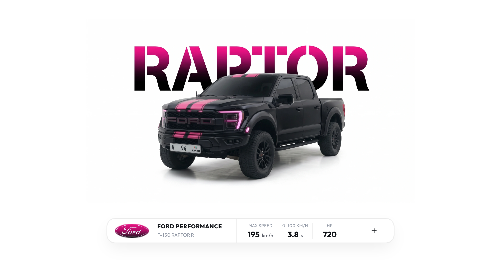
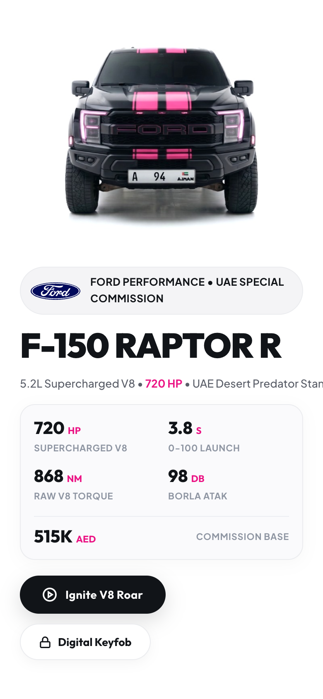

# 🏎️ Ford F-150 Raptor R — Bespoke Automotive Editorial Showcase

> High-craft automotive editorial canvas engineered with pure HTML5, vanilla CSS, and real-time Web Audio API V8 engine synthesis featuring benchmark telemetry and interactive keyfob chirp.

[](https://ibahaaaldin.github.io/hero-ford-f150-raptor-r/)
[](https://ibahaaaldin.github.io/hero-ford-f150-raptor-r/)

---

## 🌐 Visual Previews

| Cover Preview (Index Stage) | Desktop Dossier Preview | Mobile View |
| :---: | :---: | :---: |
| [](https://ibahaaaldin.github.io/hero-ford-f150-raptor-r/) | [](https://ibahaaaldin.github.io/hero-ford-f150-raptor-r/) | [](https://ibahaaaldin.github.io/hero-ford-f150-raptor-r/) |

---

## ⚡ Machine Telemetry

| Benchmark Metric | Specification Value |
| :--- | :--- |
| **Powertrain** | `5.2L Supercharged Predator V8` |
| **Peak Output** | `720 HP` |
| **Peak Torque** | `868 Nm` |
| **0–100 km/h** | `3.8 s` |
| **Top Velocity** | `195 km/h` |
| **Platform** | Full GCC heavy-duty high-ambient cooling specification |

---

## ✨ Features & Micro-Interactions

- **Editorial 100vh Gateway Canvas**: Minimalist white studio aesthetic with background stencil typography and vehicle staging.
- **Docked Spec Pill**: Segmented benchmark performance telemetry card displaying Max Speed, Acceleration, Horsepower, and brand emblem.
- **Dual Perspectives**:
  1. **Gateway Stage (`index.html`)**: Pristine high-impact vehicle presentation with bold typography.
  2. **Machine Dossier (`raptor.html`)**: Detailed machine telemetry, launch controls, and sound ignition.
- **Real-time Web Audio API Engine**:
  - Authentic V8 rumble synthesis with firing order pulses and overrun exhaust pops.
  - Interactive Remote Keyfob chirp with dual acoustic frequency lock (`2,400 Hz` to `3,200 Hz`).
- **Zero Build Dependencies**: Pure HTML5, vanilla CSS, and modular ES6 JavaScript. Runs instantly in any modern browser without `npm install`.
- **Responsive Ergonomics**: Pixel-perfect layout across desktop displays (`1200x900`+) and mobile screens (`390x844`).

---

## 📁 Repository Structure

```text
hero-ford-f150-raptor-r/
├── index.html              # Gateway editorial stage (Cover view)
├── raptor.html                 # Machine telemetry dossier with sound engine
├── styles.css              # Bespoke luxury automotive design system
├── script.js               # Web Audio API engine & interactive stage controller
├── cover.png               # Widescreen cover preview (2400x1260)
├── cover-instagram.png     # Square post cover (2160x2160)
├── screenshot-desktop.png  # High-res desktop telemetry screenshot
├── screenshot-mobile.png   # High-res mobile screenshot
├── assets/
│   ├── images/             # Ultra-HD WebP artwork & cutouts
│   ├── icons/              # Brand vectors & dock crest emblems
│   └── audio/              # Studio recordings & engine sound profiles
├── README.md               # Documentation & telemetry specs
└── CAPTION.md              # Ready-to-copy social media caption
```

---

## 🚀 Quick Start

### 1. View Locally
Simply open `index.html` in your browser:
```bash
open index.html
```

### 2. Live Demo
Visit the live interactive deployment on GitHub Pages:
**[https://ibahaaaldin.github.io/hero-ford-f150-raptor-r/](https://ibahaaaldin.github.io/hero-ford-f150-raptor-r/)**

---

## 👤 Author & Connect

**Bahaa Mohammed**  
*Creative Developer & Software Engineer*  

- 📸 **Instagram**: [@ibahaaaldincoding](https://www.instagram.com/ibahaaaldincoding)  
- 🐙 **GitHub**: [@IBahaaaldin](https://github.com/IBahaaaldin)  
- 💼 **LinkedIn**: [Bahaa Mohammed](https://www.linkedin.com/in/bahaa-mohammed-371259369)  
- 📧 **Email**: [bahaam.coding@gmail.com](mailto:bahaam.coding@gmail.com)  

---

## 📄 License

MIT © [Bahaa Mohammed](https://github.com/IBahaaaldin/hero-ford-f150-raptor-r)
